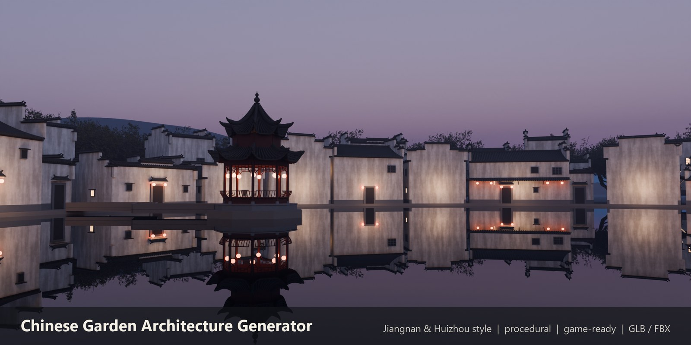
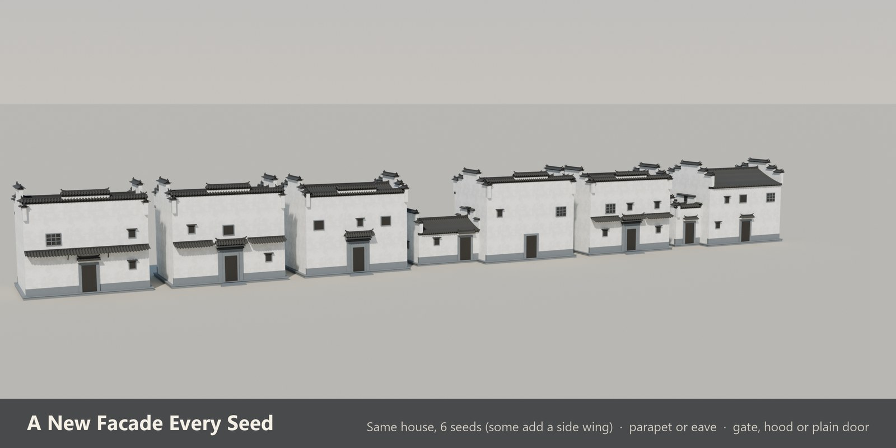
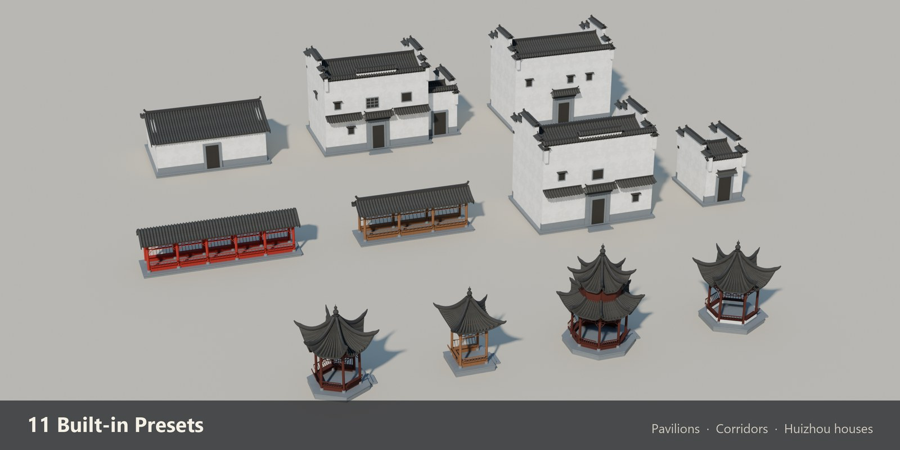
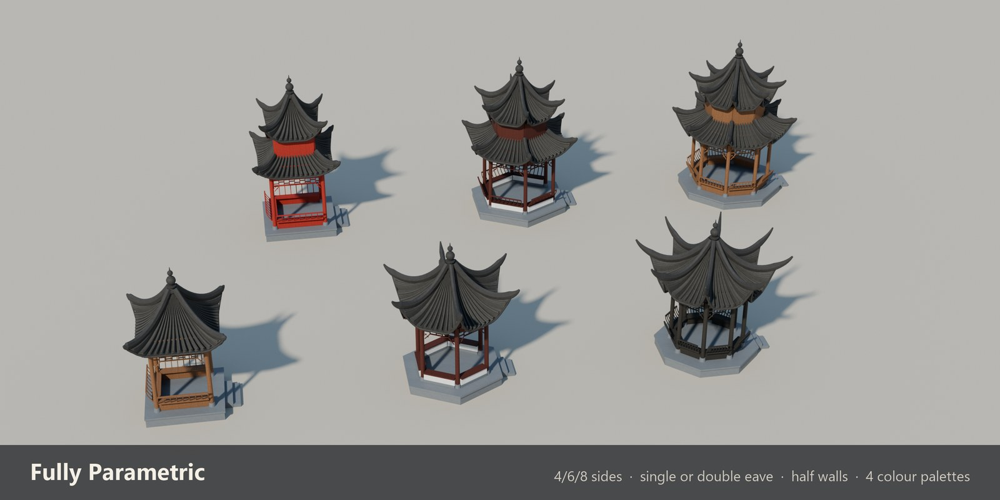
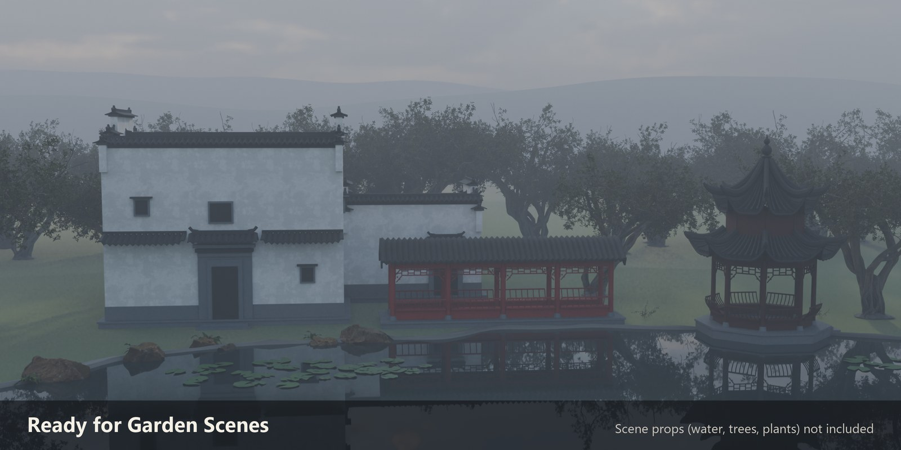
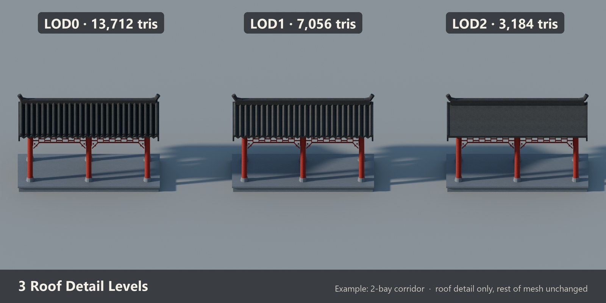
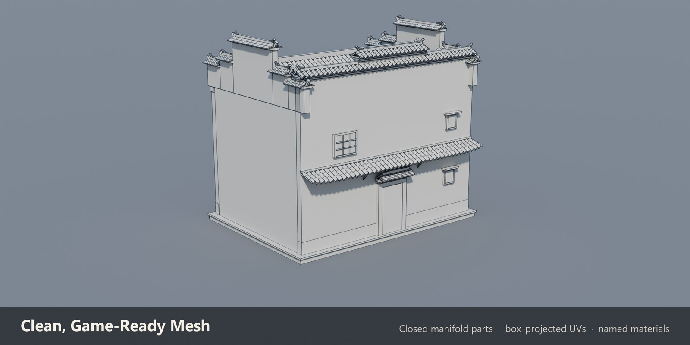
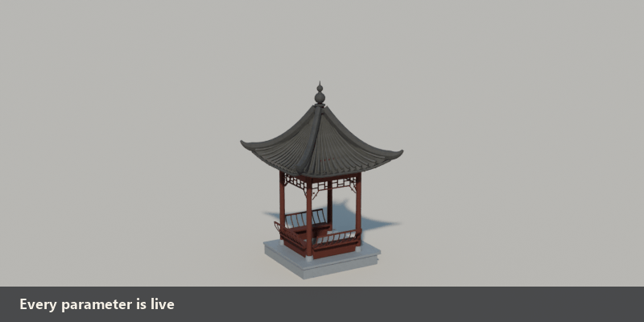

# Chinese Garden Architecture Generator (Blender add-on)

Procedural Jiangnan pavilions, covered corridors and Huizhou houses for Blender 4.2+, by **Jiangnan Workshop**.
All images are Cycles renders of the add-on's output (scene dressing such as water, trees and lanterns is added in the scene and is not generated by the add-on).

## Huizhou houses: a new facade every seed
Fire-wall parapet or open eave, brick gate tower, door hood, pent eave, side wing and irregular windows are picked by a seed or set by hand.

## 11 presets

## Pavilions
Square, hexagonal or octagonal, single or double eave, sharply upturned corners with ridge horns, gourd finial, fretwork friezes, benches or half walls, 4 lacquer palettes.

## Game-ready
3 roof detail levels, closed manifold parts, box-projected UVs (1 UV unit = 1 m), named materials with tileable CC0 textures, one-click GLB/FBX export.

